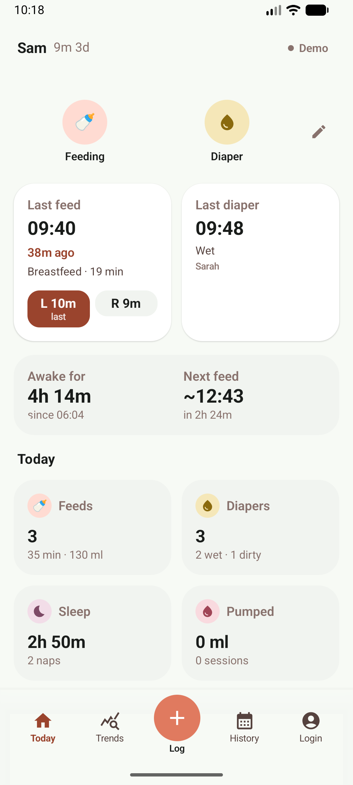
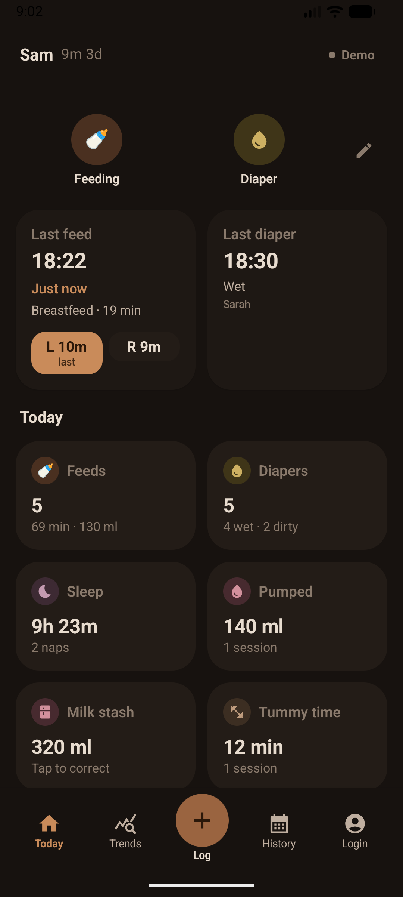
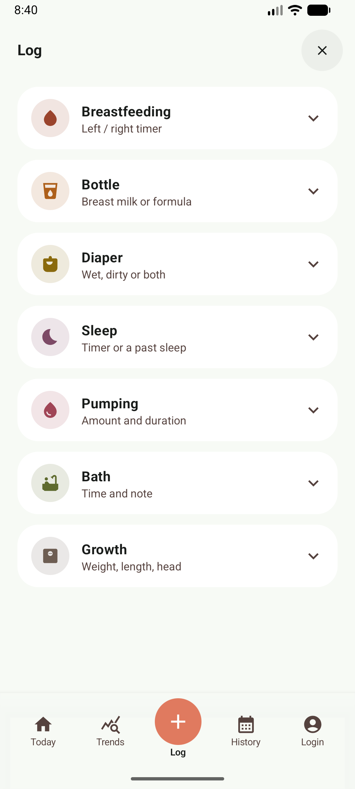
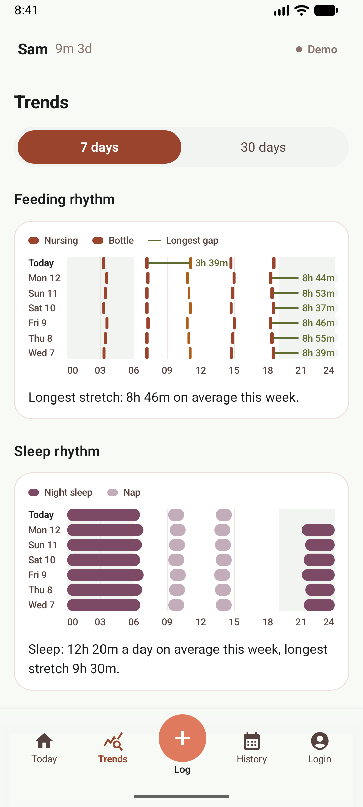
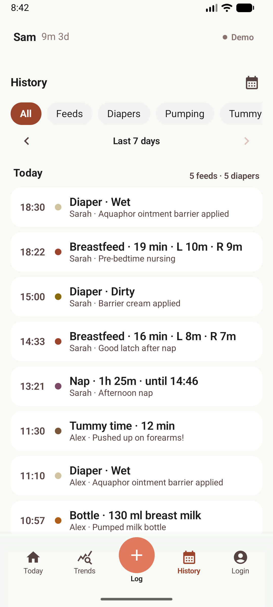
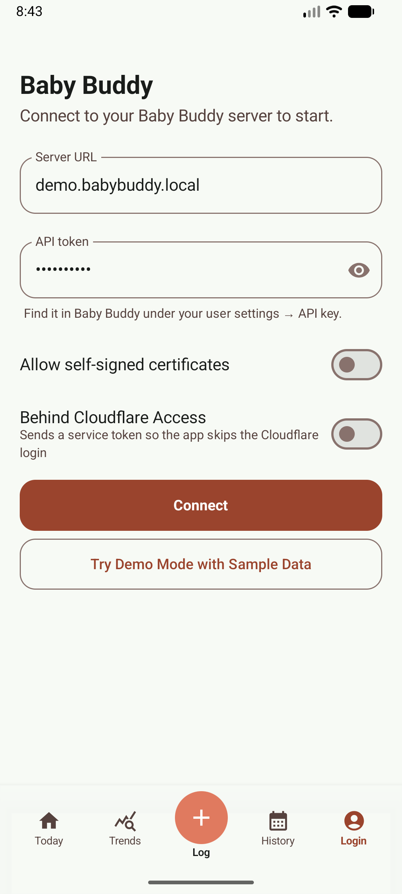
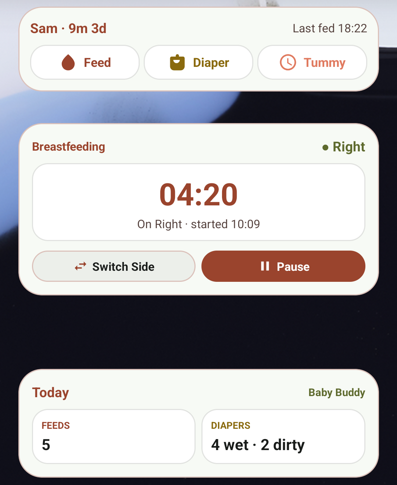
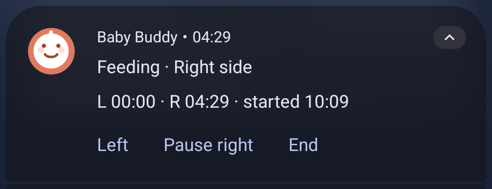
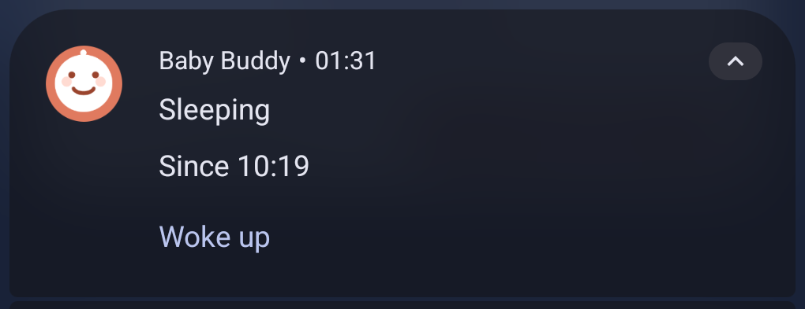

# Baby Buddy Companion (Android)

An unofficial Android client for a self-hosted [Baby Buddy](https://github.com/babybuddy/babybuddy) server — track feeding, sleep, diapers, pumping, tummy time and more, with a live nursing timer that syncs between parents' phones in real time, home-screen widgets, lock-screen notifications and offline-first sync.

> **Requires a Baby Buddy server.** This repo is *just the Android app*: it contains no backend and no database of its own. All of your data lives on (and is read from) a self-hosted [Baby Buddy](https://github.com/babybuddy/babybuddy) instance over its REST API. Without one, the app can only show the login screen. Go set up the excellent open-source [babybuddy/babybuddy](https://github.com/babybuddy/babybuddy) server first — huge props to that project; everything here builds on its API.

Built with Kotlin, Jetpack Compose and Material 3. Originally generated with Google AI Studio.

<table>
  <tr>
    <td align="center"><b>Today Dashboard (Day)</b></td>
    <td align="center"><b>Today Dashboard (Night)</b></td>
    <td align="center"><b>Quick Log</b></td>
  </tr>
  <tr>
    <td></td>
    <td></td>
    <td></td>
  </tr>
  <tr>
    <td align="center"><b>24h Trends</b></td>
    <td align="center"><b>History Timeline</b></td>
    <td align="center"><b>Settings</b></td>
  </tr>
  <tr>
    <td></td>
    <td></td>
    <td></td>
  </tr>
</table>

<sub>Screenshots use the built-in demo data.</sub>

## Features

- **Today dashboard** — at-a-glance status for the last feed, sleep, diaper, bath, tummy time and milk stash, plus optional cards (tummy time goal, temperature, notes, growth). Each tracked item has its own color across the app.
- **Nursing timer** — one-tap Left/Right side switching, per-side time correction, pause/resume, auto-end after 30 minutes idle, and a lock-screen notification with side controls. No save step: every tap is recorded through the sync queue.
- **Sleep timer** — running timer kept on the phone (survives app restarts) or manual start/end entry for past sleeps.
- **Log screen** — one list to log breastfeeding, bottle, diaper, sleep, pumping, bath and growth; tap an entry to open its form. Quick notes for your server's tags live on Today.
- **Home-screen widgets** — three widgets: **Quick log** (one-tap feed/diaper/pump/tummy-time buttons), **Timer** (live self-ticking clock with side, pause and end controls) and **Summary** (today's counts at a glance), all driven straight from the app's state.
- **Lock-screen notifications** — while a feed runs, an ongoing notification shows the live clock and Left/Right/End controls; a running sleep gets its own lock-screen timer notification. Both can be turned off in Settings.
- **Reminders & notifications** — optional "feed due", "awake for" and "asleep for" alarms that refresh from the server before posting, plus sync-status and undo toasts.
- **Growth** — weight, length and head circumference, with each measurement's percentile and charts against the [WHO Child Growth Standards](https://www.who.int/tools/child-growth-standards) (birth to 2 years).
- **History & Trends** — week-by-week history (feeds, diapers, sleep, pumping, tummy time, baths and notes, all editable) and 24-hour rhythm charts for feeding, sleep and diaper patterns.
- **Shared timers — live sync between parents.** A running breastfeed or sleep started on one phone is mirrored through the Baby Buddy timers API and shows up on every other parent's phone within seconds: the other parent sees the live clock and current side, can switch sides or end the feed, and if a timer is stopped on one device it ends everywhere. Both phones stay in sync of who started what and when (newest change wins).
- **Offline-first** — writes are queued locally and flushed in order with retry/backoff; today's entries are cached on the device.
- **Night mode** — automatic dim warm palette (by time of day or system setting).
- **12/24-hour clock**, scroll-wheel or typed time entry, per-phone tracked-item hiding, configurable quick actions.

### Home-screen widgets



Three home-screen widgets that update straight from the app's state, even when the app is closed:

- **Quick log** — one-tap Feed, Diaper and Tummy time buttons, with the baby's name, age and when they were last fed.
- **Nursing timer** — the running feed's live clock, current side and start time, with Switch side and Pause/Resume buttons.
- **Today summary** — today's feed count and wet/dirty diapers; tap to open the app.

Add them from the launcher's widget list or from **Customize Today → Phone Home Screen** in the app.

<br clear="right">

### Lock-screen controls

<table>
  <tr>
    <td></td>
    <td></td>
  </tr>
</table>

- **Feeding** — while a feed runs: the active side, each side's time and the start time, with Left / Right (pause or switch) and End buttons, usable from the lock screen.
- **Sleeping** — while a sleep is timed: when the baby fell asleep and a **Woke up** button that saves the sleep.

Both can be turned off in Settings → Notifications.

### Reminders

- **Feed Due Alarm**: Reminds you when a configurable time (e.g., 3 hours) has elapsed since the last feed started.
- **Awake For Alarm**: Alerts when the baby has been awake for a set threshold to prevent overtiredness.
- **Asleep For Alarm**: Notifies when a timed sleep session reaches a set duration limit.
- *Multi-device awareness*: Reminders verify against the Baby Buddy server before alerting, so if another caregiver logs a feed on another phone, false alarms are automatically suppressed.

## Requirements

- **A running [Baby Buddy](https://github.com/babybuddy/babybuddy) server** — this is a hard requirement, not optional. This app is a pure client; the server stores every feeding, sleep, diaper change, etc. and exposes them over its REST API. Install it from [github.com/babybuddy/babybuddy](https://github.com/babybuddy/babybuddy) (Docker or bare metal) before using this app.
- Android 7.0+ (minSdk 24).
- To build: [Android Studio](https://developer.android.com/studio) (latest, AGP 9.4 / compileSdk 37), or JDK 17+ (21 recommended) with the Gradle wrapper.

## Getting started

### Install

Download the APK from the [latest release](https://github.com/liorbass/baby-buddy-modern-android/releases/latest) and open it on your phone (allow installing apps from your browser when Android asks). New releases install over the old one. To get updates automatically, add this repository to [Obtainium](https://github.com/ImranR98/Obtainium).

From 1.1.0 the app ID is `dev.liorbass.babybuddy`; 1.0.x was a different app ID, so uninstall it after moving over (log in again once).

### Build

```bash
git clone https://github.com/liorbass/baby-buddy-modern-android.git
cd baby-buddy-modern-android
./gradlew assembleDebug        # APK at app/build/outputs/apk/debug/app-debug.apk
```

or open the project in Android Studio and run the `app` configuration.

Notes:

- **Signing:** debug builds use the standard Gradle debug key (or a gitignored `debug.keystore` in the repo root, if present). An APK you build yourself can't update one installed from the releases (different signing key), and vice versa.

### Contributing setup

Checks run through [pre-commit](https://pre-commit.com) (`.pre-commit-config.yaml`): file hygiene, gitleaks secret scanning, ktlint formatting (Java 11+ on `PATH`), actionlint, and blocks on keystores, `.env`, APKs and data exports. Install once per clone, from the same environment you commit from (on Windows: a Windows terminal, so Android Studio's commits use it):

```bash
pipx install pre-commit          # or: uv tool install pre-commit / pip install pre-commit
pre-commit install
cp tools/hooks/blocklist.example tools/hooks/blocklist.local   # names/addresses to keep out of git (gitignored)
```

`pre-commit run --all-files` checks everything; `pre-commit autoupdate` bumps hook versions. The same checks run in CI (`.github/workflows/checks.yml`).

### Connect to your server

1. Install and launch the app.
2. Enter your Baby Buddy server URL (e.g. `https://baby.example.com`), your API token (from the Baby Buddy web UI under your user profile) and the child's name.
3. Optionally set a Cloudflare Access service token if your server sits behind Cloudflare Access.
4. Plain `http://` addresses work too (e.g. a server on your home network), but the token is then sent unencrypted; prefer HTTPS or a VPN away from home.
5. If your server uses a self-signed certificate, turn on **Allow self-signed certificates**. This switches off certificate checking for the connection, so only use it on a network you trust (a VPN or your home network).

The API token and Cloudflare secret are stored encrypted with an Android Keystore key. Without a saved login the app shows only the login screen.

### Run tests

```bash
./gradlew testDebugUnitTest        # JVM/Robolectric unit tests
./gradlew connectedDebugAndroidTest # instrumented tests (needs a device/emulator)
```

## Project layout

```
app/src/main/java/com/example/
├── BabyBuddyApplication.kt   # app entry; attaches repository, syncs widgets/notifications
├── MainActivity.kt           # navigation switch, theming, screen host
├── data/
│   ├── api/                  # Retrofit service + DTOs for the Baby Buddy REST API
│   ├── model/                # UI models, time formatting
│   └── repository/           # BabyBuddyRepository (single source of truth), offline
│                             # store, write queue, shared timers, secret cipher
├── ui/
│   ├── MainViewModel.kt      # UI state, toasts, screen navigation
│   ├── components/           # shared composables (forms, dialogs, pickers, widget cards)
│   ├── screens/              # Today, Log, History, Trends, Sleep, Settings, ...
│   └── theme/                # colors (incl. night mode), type, theme
└── widget/                   # home-screen widgets, notifications, reminders
```

See [docs/ARCHITECTURE.md](docs/ARCHITECTURE.md) for a detailed architecture guide (state flow, sync/write queue, shared timers, server field mappings, navigation) and [docs/ICD.md](docs/ICD.md) for the interface control document (how the app talks to the Baby Buddy backend).

## How data maps to the server

The app uses only stock Baby Buddy API endpoints (`/api/children`, `/api/feedings`, `/api/sleep`, `/api/changes`, `/api/tummy-times`, `/api/pumping`, `/api/temperature`, `/api/weight`, `/api/height`, `/api/head-circumference`, `/api/notes`, `/api/tags`, `/api/timers`). Features the server has no fields for are stored in `notes` with a parseable format:

- caregiver name (`Caregiver: …`), breastfeed side split (`Left: … | Right: … | Sides: …`)
- diaper rash/cream/consistency (`Rash | Cream: … | Consistency: …`)
- baths (a note tagged `bath`), milk stash (a note tagged `milk-stash`)
- length is stored in `/api/height` (the WHO uses lying-down length under 2 years)

Settings kept only on the phone: your caregiver name, theme, clock format, reminders, tracked items, Today cards, and the boy/girl choice used to pick the WHO charts (Baby Buddy has no such field).

## Privacy

- The app talks only to your own Baby Buddy server (and Cloudflare Access, if you configure it). No analytics, ads or tracking.
- Your API token and Cloudflare secret are encrypted on the phone with an Android Keystore key and excluded from backups, as are the offline queue and cache.

## Permissions

| Permission | Why |
|---|---|
| Internet | Talk to your Baby Buddy server |
| Notifications (Android 13+, asked when lock-screen timers or reminders are on) | Lock-screen feed/sleep timers and reminders |
| Run at startup | Set reminders again after the phone restarts (alarms don't survive a restart) |
| Run in the background (foreground service) | Only while a feed or sleep is being timed: keeps the lock-screen timer in step with the other parent's phone, so a feed ended there also ends here |

No location, contacts, camera, microphone or storage access.

## Medical disclaimer

Growth percentiles and charts are for information only. They are not medical advice and not a diagnosis; talk to your pediatrician or health visitor about your child's growth, feeding or sleep.

## Credits

- [Baby Buddy](https://github.com/babybuddy/babybuddy) — the server, data model and REST API this app is built on.
- [WHO Child Growth Standards](https://www.who.int/tools/child-growth-standards) — growth reference data (WHO Multicentre Growth Reference Study Group, 2006), from the WHO's published expanded tables; see `WhoGrowthStandards.kt`.

## Disclaimer

This is an independent, unofficial client. It is not affiliated with or endorsed by the Baby Buddy project. All credit for the Baby Buddy data model, REST API and the original web app goes to [babybuddy/babybuddy](https://github.com/babybuddy/babybuddy) and its contributors — this repo is only a mobile front end for it.
This repo was vibe coded for my own personal use, if you don't like something/want a feature, submit an issue, if you don't like the response, go and fork yourself.

## License

[Apache License 2.0](LICENSE)
