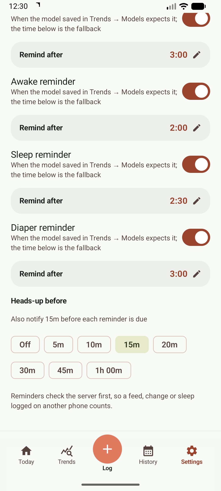
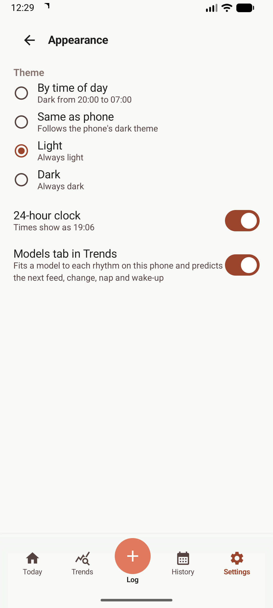
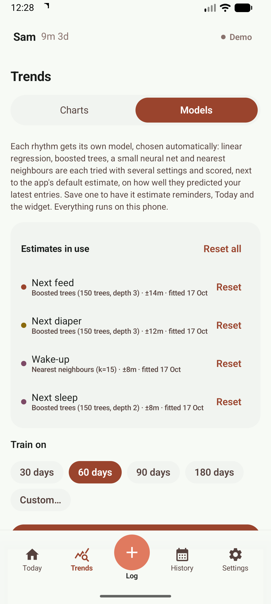
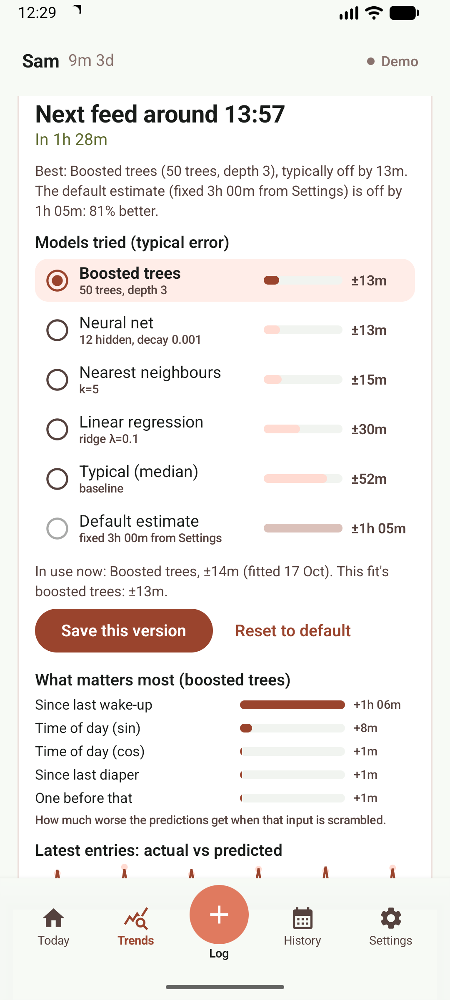
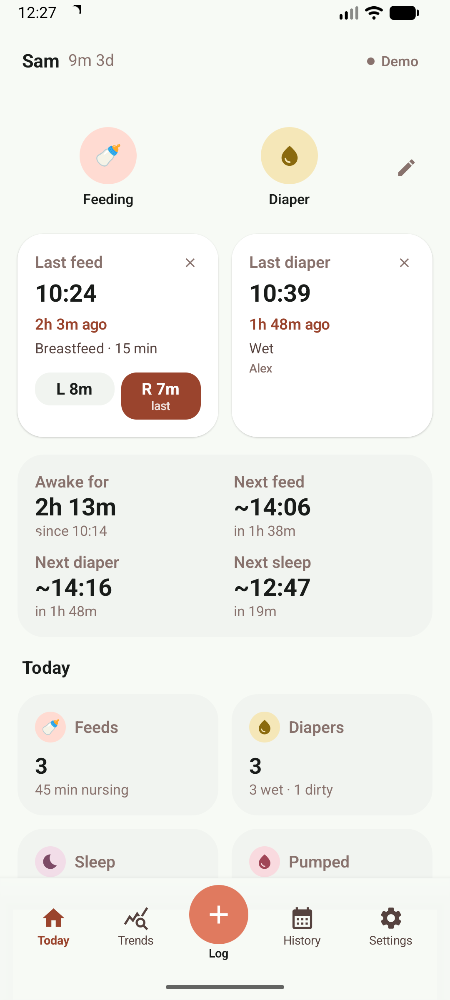

# Features in detail

A closer look at the widgets, lock-screen controls, tiles, reminders and rhythm models. The [README](../README.md) has the overview.

## Home-screen widgets

Three home-screen widgets that update straight from the app's state, even when the app is closed:

- **Quick log** — one-tap Feed, Diaper and Tummy time buttons, with the baby's name, age and when they were last fed.
- **Nursing timer** — the running feed's live clock, current side and start time, with Switch side and Pause/Resume buttons.
- **Today summary** — today's feed count and wet/dirty diapers, plus the next feed/diaper/nap when [rhythm models](#rhythm-models) are in use; tap to open the app.

Add them from the launcher's widget list or from **Customize Today → Phone Home Screen** in the app.

 

## Lock-screen controls

<table>
  <tr>
    <td></td>
    <td></td>
  </tr>
</table>

- **Feeding** — while a feed runs: the active side, each side's time and the start time, with Left / Right (pause or switch) and End buttons, usable from the lock screen.
- **Sleeping** — while a sleep is timed: when the baby fell asleep and a **Woke up** button that saves the sleep.

Both can be turned off in Settings → Notifications. There you can also turn on **What's next on lock screen**: a silent notification that counts down to the next feed, then lists the next diaper change and nap (from the reminder intervals or a saved [rhythm model](#rhythm-models)), shown while no feed or sleep is timed.

## Quick Settings tiles and shortcuts

Edit your Quick Settings panel to add **Breastfeed** (tap to start, on the side chosen in Settings → You: opposite the last feed by default, the same side, or always left/right; tap again to pause or resume), **Sleep** (tap when asleep, again when awake; the sleep is saved) and **Diaper** (opens the diaper log). Long-press a tile to open its screen. Long-press the app icon for **Feed left**, **Feed right**, **Diaper** and **Sleep now**.

## Reminders

Settings → Notifications:

- **Feed reminder**: when a set time (e.g. 3 hours) has passed since the last feed started.
- **Awake reminder**: when the baby has been awake for a set time, to catch the nap window.
- **Sleep reminder**: when a timed sleep reaches a set length.
- **Diaper reminder**: when a set time has passed since the last change.
- **Heads-up before**: also notify 5, 10, 15, 20, 30, 45 or 60 minutes before any of these is due ("Feed due in 15m"); the due notification replaces it.
- With a [rhythm model](#rhythm-models) saved for that rhythm, the reminder fires when the model expects it instead of after the fixed time (which stays as the fallback).
- *Multi-device awareness*: reminders check the Baby Buddy server before alerting, so a feed or change logged on another phone cancels them.

 

## Rhythm models

An optional tab in Trends that learns your baby's rhythm, on the phone, and can use it to estimate what's next.

**Turn it on:** Settings → Appearance → **Models tab in Trends**. Then open **Trends → Models**.

<table>
  <tr>
    <td></td>
    <td></td>
    <td></td>
    <td></td>
  </tr>
</table>

1. **Pick the history to learn from**: the last 30, 60, 90 or 180 days, or **Custom…** for any date range (e.g. to leave out a week of illness). Tap **Fit models**; it takes a few seconds to a minute.
2. **Four rhythms**, each with its own model: time to the **next feed**, the **next diaper change**, how long a **sleep** lasts (the expected wake-up) and how long the baby stays **awake** between sleeps (the next nap). Each model's inputs include the time of day, the baby's age, the previous intervals, the time since the last feed/change/wake-up, the feed's length and amount, and the last 24 hours' totals.
3. **AutoML** tries linear regression, gradient-boosted trees, a small neural network, nearest neighbours and the recent median by time of day (the last 7 or 14 days, in 4-, 6- or 12-hour windows), each with several settings, and scores them by how well they predicted your most recent entries when trained only on older ones. Each card shows every family's best typical error **next to the default estimate's** (the reminder's fixed interval, or the average interval when none is set), which inputs matter most, and a chart of actual vs predicted.
4. **Use it**: pick a model in the list (the best is selected) and tap **Use …**. After fitting again later, **Save this version** replaces the saved model for that rhythm; the card shows the saved and new errors side by side.
5. **Revert any time**: **Reset to default** on a card, or **Reset** / **Reset all** under *Estimates in use* at the top of the tab, goes back to the default estimate.

A saved model then sets the time for that rhythm's **reminder**, Today's **Next feed / Next diaper / Next sleep / Wake-up** card and the **summary widget**'s "Next:" line, recalculated whenever a feed, change or sleep is logged on any phone. Once that time has passed with nothing logged, Today, the widget and the next-up notification move it to the middle of the model's past outcomes that ran this long (from its validation errors); the reminder still fires at the original time. Everything (training and the saved models) stays on the phone; the server only provides your entries. The demo mode starts with models fitted and in use.

Predictions are estimates from past patterns, not advice; babies change quickly, so fit again every week or two.

## While you were away

When you come back to the app, Today shows a **While you were away** card listing the feeds, diaper changes and sleeps that other caregivers logged since you last had the app open (up to the last 24 hours). An entry counts as someone else's when it doesn't carry your name (Settings → You); without a name set, only entries that name a caregiver count. Tap the card to open History, or ✕ to dismiss it.
